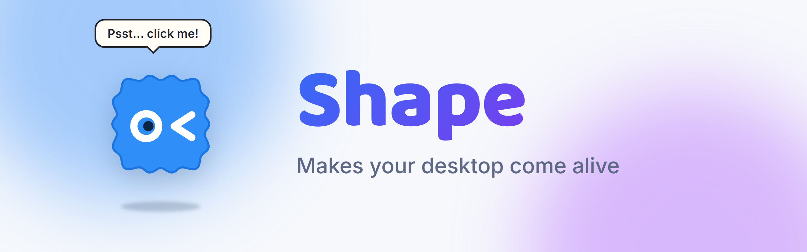
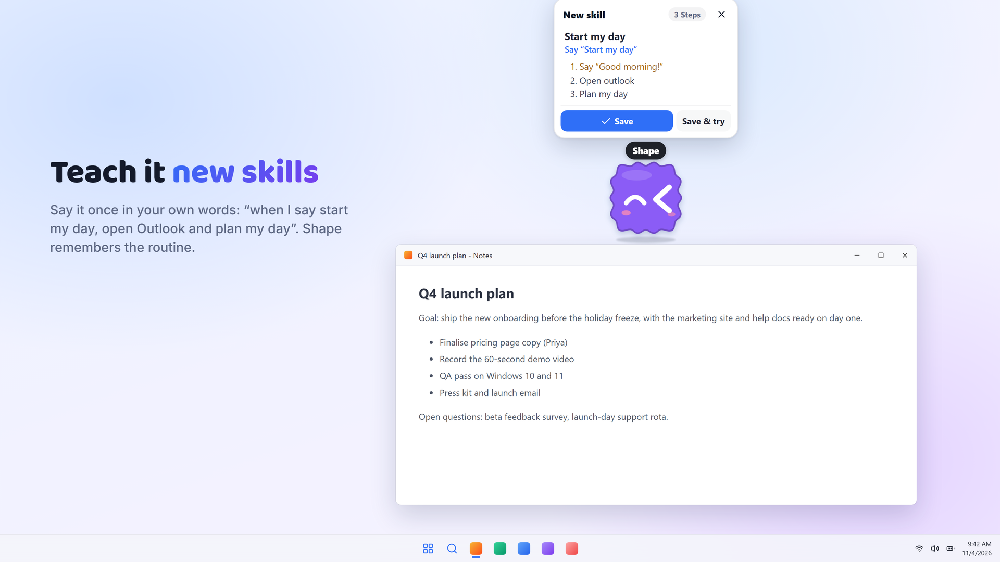
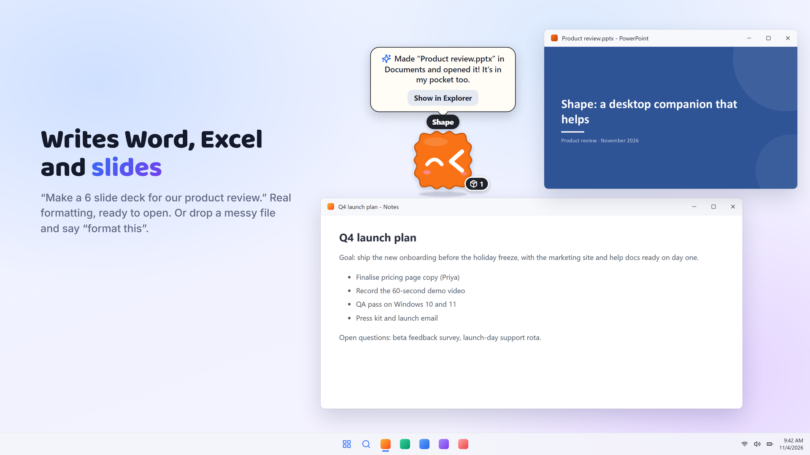
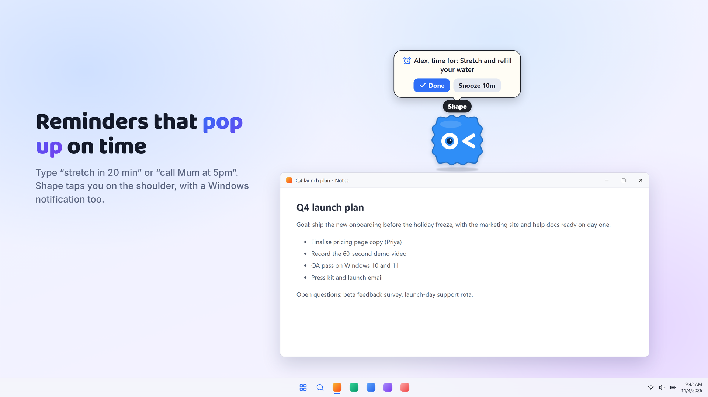
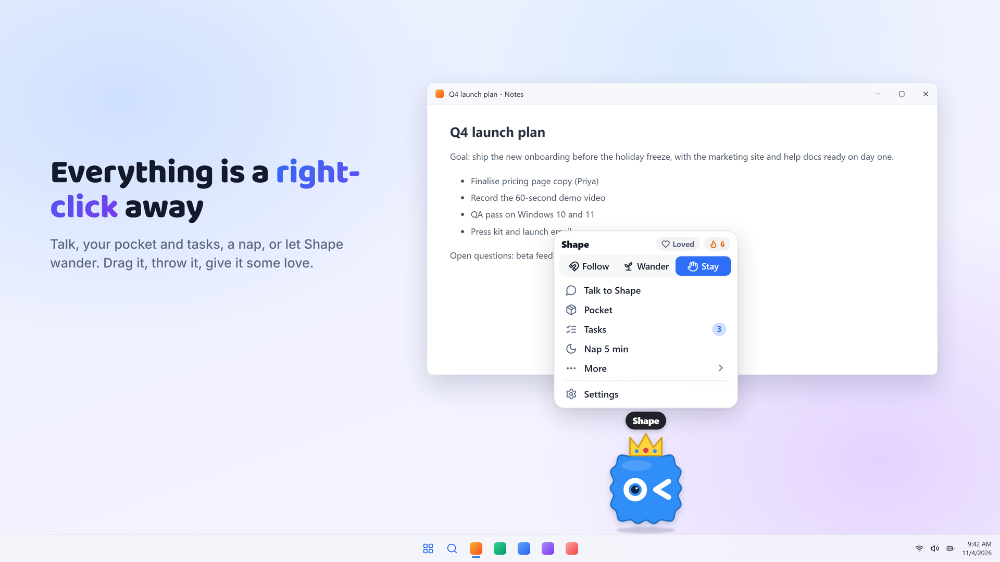
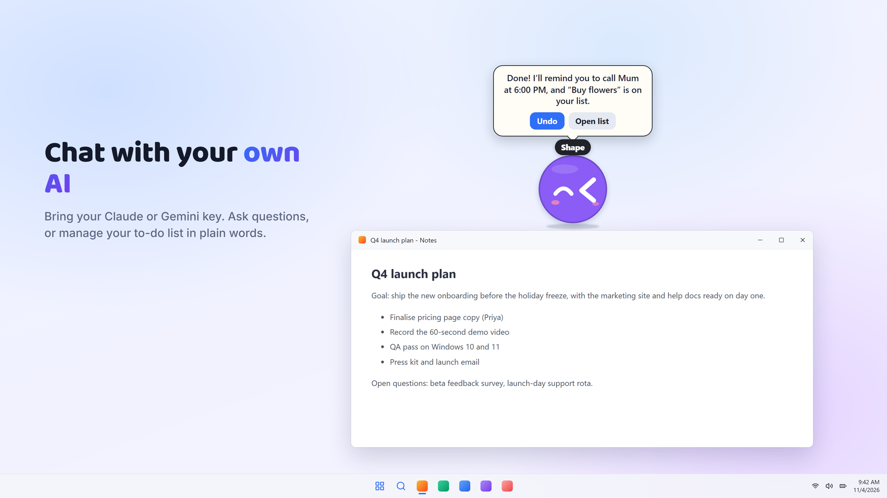
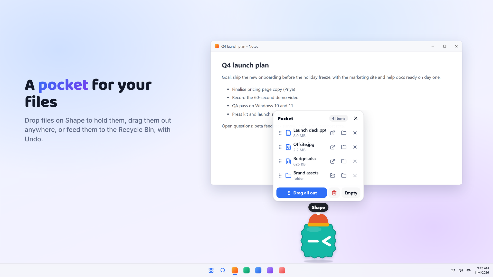
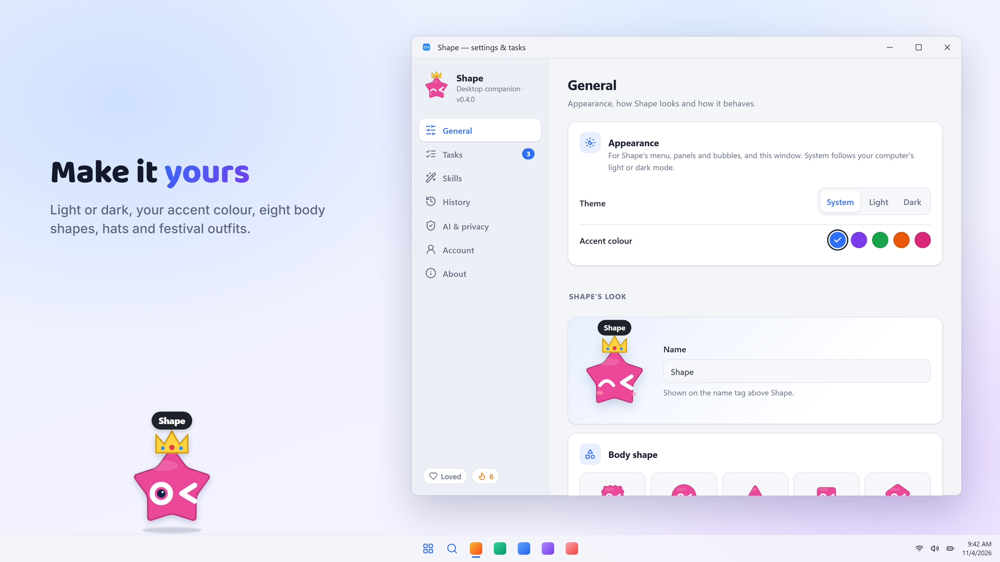
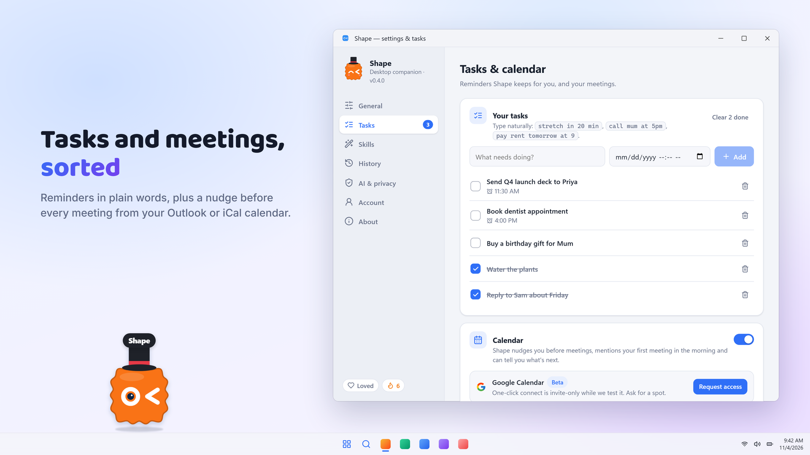

<p align="center">
  <a href="https://xshape.pages.dev"></a>
</p>

<p align="center">
  <b>A tiny, playful companion that lives on your Windows desktop.</b><br>
  It gets things done when you ask: opens apps, tidies folders, finds files, writes Word, Excel and PowerPoint files,<br>learns new skills in your own words, and reminds you about tasks and meetings.
</p>

<p align="center">
  <a href="https://apps.microsoft.com/detail/9P7SGTZ8CBTW?mode=direct"></a>
</p>

<p align="center">
  <a href="https://github.com/heyabhiraj/shape-releases/releases/latest"><b>⬇ Direct download</b></a>
  &nbsp;·&nbsp;
  <a href="https://xshape.pages.dev"><b>🌐 Website</b></a>
  &nbsp;·&nbsp;
  <a href="https://github.com/heyabhiraj/shape-releases/releases">What's new</a>
  &nbsp;·&nbsp;
  <a href="https://xshape.pages.dev/guide">Docs</a>
</p>

<p align="center">Free · No ads · Windows 10 &amp; 11 · <a href="https://xshape.pages.dev/mac">Mac (beta)</a></p>

---

## See it in action

<p align="center">
  <a href="https://github.com/heyabhiraj/shape-releases/raw/main/media/shape-trailer.mp4"></a>
  <br><sub><a href="https://github.com/heyabhiraj/shape-releases/raw/main/media/shape-trailer.mp4">Watch the full trailer in HD (MP4, 46 s)</a></sub>
</p>

<table>
  <tr>
    <td width="50%"><br><b>Teach it new skills</b></td>
    <td width="50%"><br><b>Writes Word, Excel and slides</b></td>
  </tr>
  <tr>
    <td width="50%"><br><b>Reminders that pop up on time</b></td>
    <td width="50%"><br><b>Everything is a right-click away</b></td>
  </tr>
  <tr>
    <td width="50%"><br><b>Chat with your own AI</b></td>
    <td width="50%"><br><b>A pocket for your files</b></td>
  </tr>
  <tr>
    <td width="50%"><br><b>Make it yours</b></td>
    <td width="50%"><br><b>Tasks and meetings, sorted</b></td>
  </tr>
</table>

## What it does

- **Just ask.** "open Spotify", "organise my Downloads", "find PDFs from last week", "close all Chrome windows", "focus 25 min". Changes are shown first, and Undo puts everything back.
- **Teach it new skills.** "when I say start my day, open Outlook and plan my day", or "every weekday at 9am, show my tasks".
- **Word, Excel and PowerPoint.** "make an Excel budget", "write a cover letter in Word", "make a 6 slide deck about our Q4 plan". Drop a messy file on Shape and say "format this" for a clean copy.
- **Alive on your screen.** Drag it, throw it, shake it until it's dizzy. It walks on your windows, follows your cursor if you like, and naps when you're away.
- **Reminders in plain words.** Type "stretch in 20 min" or "call Mum at 5pm". Shape pops up on time, with a Windows notification too.
- **Meeting nudges.** Add your Outlook or iCal calendar link and Shape lets you know a few minutes before each meeting.
- **A pocket for files.** Drop files on Shape to hold them, drag them out anywhere, or feed them to the Recycle Bin, with Undo.
- **AI chat (optional).** Bring your own Claude or Gemini key to ask questions (with answers from the web) or manage your to-do list by chatting.
- **Polite in meetings.** Goes quiet when you present, go fullscreen or join a call, and stays invisible in screen shares.
- **Remembers you.** Your name, birthdays and the little things you tell it, a morning briefing, and streaks.
- **Make it yours.** Light, dark or system theme with your accent colour, eight body shapes, hats and faces to unlock, and festival outfits. New ones arrive over time.

New here? The [Docs](https://xshape.pages.dev/guide) have getting started, tutorials, use cases and a cheat sheet.

## Install

**Easiest:** get Shape from the [Microsoft Store](https://apps.microsoft.com/detail/9P7SGTZ8CBTW?mode=direct). It's free, installs in one click, and the Store keeps it up to date.

**Or download the installer:**

1. Open the [latest release](https://github.com/heyabhiraj/shape-releases/releases/latest) and download **`Shape_<version>_x64-setup.exe`** (about 5 MB).
2. Run it. No admin rights needed; it installs just for you.
3. If Windows says *"Windows protected your PC"*, click **More info → Run anyway**. This appears because the installer isn't signed with a paid certificate; the Microsoft Store version doesn't show it.

Shape starts right away. **Right-click it** for the menu; the tray icon shows or hides it.

### Mac (beta)

1. From the [latest release](https://github.com/heyabhiraj/shape-releases/releases/latest), download **`Shape_<version>_universal.dmg`** (Apple Silicon and Intel), open it and drag **Shape** into **Applications**.
2. Shape isn't signed with an Apple Developer ID yet, so macOS says *"Shape can't be opened"* until you allow it once. In **Terminal**:
   ```sh
   xattr -dr com.apple.quarantine /Applications/Shape.app
   ```
3. Open Shape from Applications, or start it from Terminal (shows its messages if something goes wrong):
   ```sh
   /Applications/Shape.app/Contents/MacOS/shape-desktop
   ```

More tips on the [Mac page](https://xshape.pages.dev/mac). Push-to-talk isn't on Mac yet.

## Updates

The Microsoft Store version is updated by the Store. The installer and Mac versions keep themselves up to date: it downloads new versions in the background and installs them while you're away from your PC, never during a meeting or presentation, then tells you what's new. Prefer to decide yourself? Turn off **Settings → About → Install updates automatically** and Shape will ask first. Updates are cryptographically signed, so only genuine Shape releases install.

## Requirements

**Windows:** 10 or 11, 64-bit. Shape uses Microsoft Edge WebView2, which comes with Windows 11; the installer adds it on Windows 10 if it's missing.

**Mac:** macOS 11 Big Sur or later, Apple Silicon or Intel.

## Privacy

Your tasks, memories, chats and files stay on your PC. No ads, no tracking. An account is optional, and AI chat is off until you turn it on with your own key.
Read the [Privacy Policy](https://xshape.pages.dev/privacy) and [Terms of Use](https://xshape.pages.dev/terms).

## Help

- Something not working? In Shape, open **Settings → About → Report a problem** (it writes an email with Shape's log), or [open an issue](https://github.com/heyabhiraj/shape-releases/issues).
- Email: [shapexdev@proton.me](mailto:shapexdev@proton.me)
- Uninstall: Windows Settings → Apps → Installed apps → Shape → Uninstall.

---

<sub>This repository hosts Shape's installers and the update feed used by installed copies. © 2026 X Shape dev.</sub>
