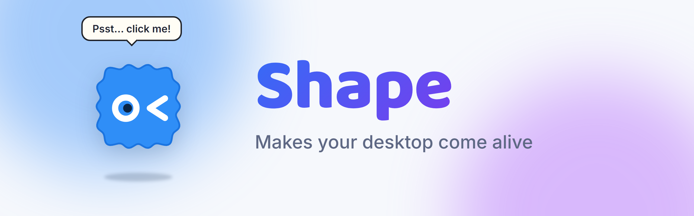
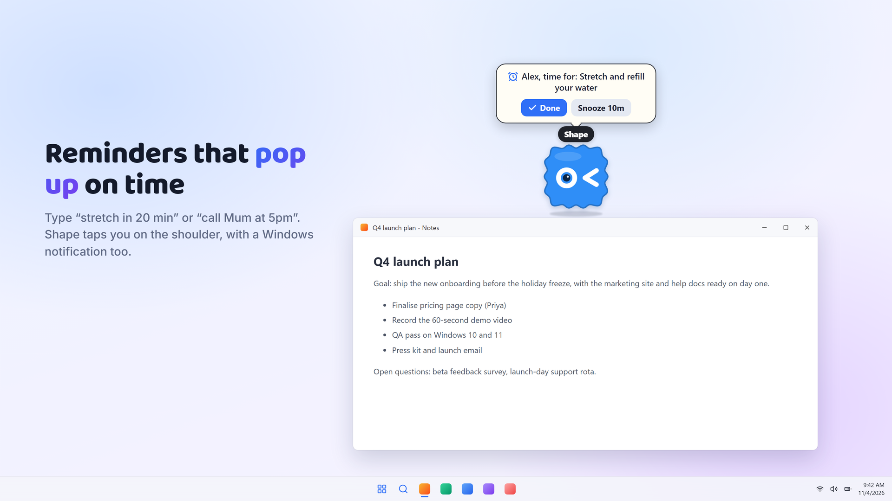
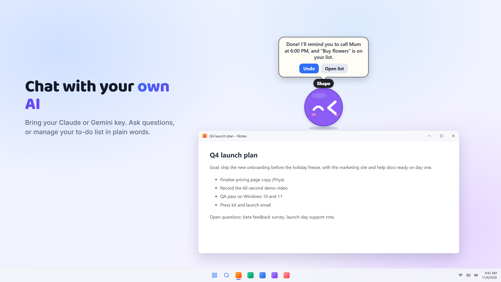
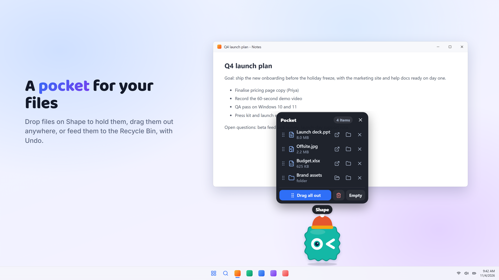
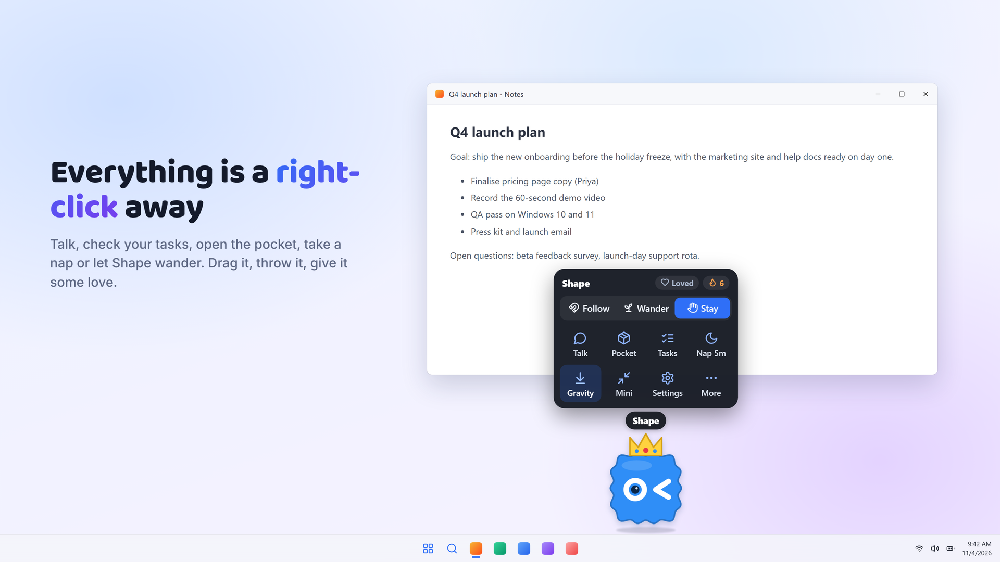
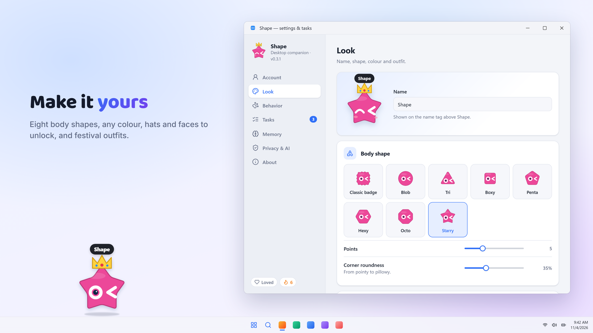
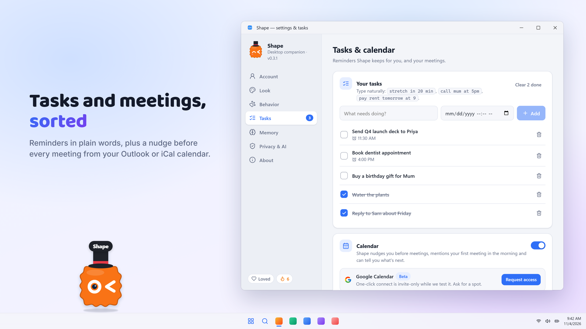

  

  <b>A tiny, playful companion that lives on your Windows desktop.</b> 
  It wanders around your screen, reminds you about tasks and meetings, holds your files and cheers you on.

  <a href="https://github.com/heyabhiraj/shape-releases/releases/latest"><b>⬇ Download for Windows</b></a>
  &nbsp;·&nbsp;
  <a href="https://xshape.pages.dev"><b>🌐 Website</b></a>
  &nbsp;·&nbsp;
  <a href="https://github.com/heyabhiraj/shape-releases/releases">What's new</a>
  &nbsp;·&nbsp;
  <a href="https://github.com/heyabhiraj/shape-releases/issues">Report a problem</a>

Free · No ads · Windows 10 &amp; 11 · Coming soon to the Microsoft Store

---

## See it in action

  
   <a href="https://github.com/heyabhiraj/shape-releases/raw/main/media/shape-trailer.mp4">Watch the full trailer in HD (MP4, 28 s)</a>

<table>
  <tr>
    <td width="50%"> <b>Reminders that pop up on time</b></td>
    <td width="50%"> <b>Chat with your own AI</b></td>
  </tr>
  <tr>
    <td> <b>A pocket for your files</b></td>
    <td> <b>Everything is a right-click away</b></td>
  </tr>
  <tr>
    <td> <b>Make it yours</b></td>
    <td> <b>Tasks and meetings, sorted</b></td>
  </tr>
</table>

## What it does

- **Alive on your screen.** Drag it, throw it, shake it until it's dizzy. It walks on your windows, follows your cursor if you like, and naps when you're away.
- **Reminders in plain words.** Type "stretch in 20 min" or "call Mum at 5pm". Shape pops up on time, with a Windows notification too.
- **Meeting nudges.** Add your Outlook or iCal calendar link and Shape lets you know a few minutes before each meeting.
- **A pocket for files.** Drop files on Shape to hold them, drag them out anywhere, or feed them to the Recycle Bin, with Undo.
- **AI chat (optional).** Bring your own Claude or Gemini key to ask questions or manage your to-do list by chatting.
- **Polite in meetings.** Goes quiet when you present, go fullscreen or join a call, and stays invisible in screen shares.
- **Remembers you.** Your name, birthdays and the little things you tell it, a morning briefing, and streaks.
- **Make it yours.** Eight body shapes, any colour, hats and faces to unlock, and festival outfits. New ones arrive over time.

## Install

1. Open the [latest release](https://github.com/heyabhiraj/shape-releases/releases/latest) and download **`Shape_<version>_x64-setup.exe`** (about 5 MB).
2. Run it. No admin rights needed; it installs just for you.
3. If Windows says *"Windows protected your PC"*, click **More info → Run anyway**. This appears because the installer isn't signed with a paid certificate. The Microsoft Store version won't show it.

Shape starts right away. **Right-click it** for the menu; the tray icon shows or hides it.

## Updates

Shape keeps itself up to date: it downloads new versions in the background and installs them while you're away from your PC, never during a meeting or presentation, then tells you what's new. Prefer to decide yourself? Turn off **Settings → About → Install updates automatically** and Shape will ask first. Updates are cryptographically signed, so only genuine Shape releases install.

## Requirements

Windows 10 or 11, 64-bit. Shape uses Microsoft Edge WebView2, which comes with Windows 11; the installer adds it on Windows 10 if it's missing.

## Privacy

Your tasks, memories, chats and files stay on your PC. No ads, no tracking. An account is optional, and AI chat is off until you turn it on with your own key.
Read the [Privacy Policy](https://xshape.pages.dev/privacy) and [Terms of Use](https://xshape.pages.dev/terms).

## Help

- Something not working? In Shape, open **Settings → About → Report a problem**, or [open an issue](https://github.com/heyabhiraj/shape-releases/issues).
- Email: [shapexdev@proton.me](mailto:shapexdev@proton.me)
- Uninstall: Windows Settings → Apps → Installed apps → Shape → Uninstall.

---

This repository hosts Shape's installers and the update feed used by installed copies. © 2026 X Shape dev.
